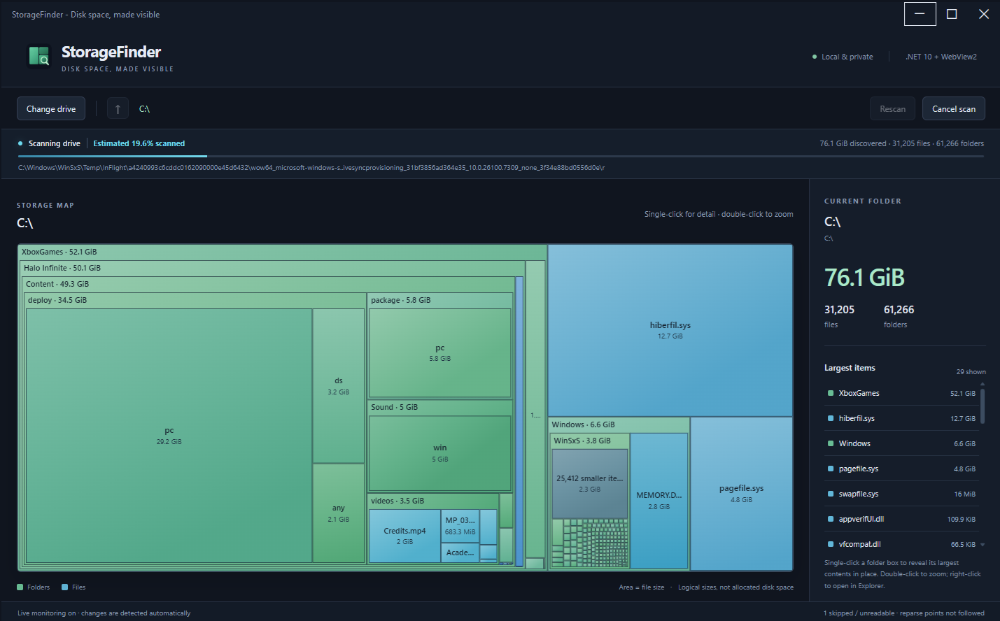

# StorageFinder

An app to find where the disk space went on your machine. Inspired by other treemap view apps that show your disk usage. Free and open source, written in .NET 10.



## Run

Requires Windows, the .NET 10 Desktop Runtime, and the Microsoft Edge WebView2 Runtime. This project does not install runtimes or download browsers.

```powershell
dotnet run --project .\src\StorageFinder.App --configuration Release
```

Create a framework-dependent distribution:

```powershell
dotnet publish .\src\StorageFinder.App --configuration Release --output .\artifacts\StorageFinder
.\artifacts\StorageFinder\StorageFinder.exe
```

Keep the executable together with its adjacent files and `Web` directory.

## Explore

- Choose a drive. Scanning runs on a worker thread and publishes partial maps roughly every 300 ms. The top percentage and progress bar estimate coverage from discovered logical bytes divided by the drive's used space at scan start. This is not an exact workload measurement: hard links, compression, sparse files, and unreadable entries affect it. The estimate is capped at 99% until enumeration finishes, when it changes to 100%. Live updates do not restart the progress bar.
- Green rectangles are folders; blue/cyan rectangles are files. Labels show names and binary sizes. Hover for exact bytes.
- Single-click a folder box to reveal more of its largest contents **inside the same box**, without zooming. **Reset detail** restores normal rendering. Selecting another folder box moves the override to that branch; zooming or rescanning clears it. With the canvas focused, **Space** previews the selected folder.
- Double-click a folder or press Enter on its entry in the largest-items list to zoom. Double-clicking a file zooms its containing folder.
- Right-click a rectangle or a largest-items entry. Folders only offer **Open folder in Explorer** to open the folder directly. Files offer **Open containing folder in Explorer** to open their parent with the file selected and focused; files are not opened. **Shift+F10** opens the menu, and **Escape** dismisses it.
- Use breadcrumbs, the up-arrow button, or **Alt+Up** to go back. Zero-byte files and empty folders have no area but remain in the list.
- A recursive filesystem watcher tracks creates, writes, deletes, and renames. Repeated notifications are coalesced by path; only changed entries are updated. If Windows loses notifications, a background directory comparison reconciles missing changes in place, preserving the current map and zoom. Only the explicit **Rescan** command clears the index and starts a full scan.
- **Rescan** refreshes the entire drive. **Change drive** and **Cancel scan** stop the current scanner and watcher.

Sizes are logical file lengths, not allocated disk usage. Hard links can be counted more than once; compression, sparse files, filesystem metadata, and inaccessible files mean totals can differ from Explorer's used-space figure. Reparse points (junctions, symbolic links, and some cloud placeholders) are skipped to avoid loops or fetching cloud content. Unreadable entries are counted and their latest error is shown. No elevation is requested.

### Detail thresholds

All pixel measurements below are CSS pixels, independent of display scaling.

| Limit | Normal view | Single-click override |
| --- | --- | --- |
| Minimum folder box to lay out children | 62 x 58 px | 12 x 12 px |
| Hierarchy detail | 5 levels below the current view | Up to 12 levels below the clicked folder, with an overall 24-level limit per view |
| Individually projected children per folder | Largest 180 | Largest 1,000 in the selected branch |
| Total nodes per snapshot | 5,000 | Up to 10,000: the unchanged normal projection plus a separate 5,000-node detail allowance |
| Omitted descendant tiles | Either side under 1 px | Either side under 4 px, or area under 64 square px |

Normal expanded folders reserve a 23 px header and 3 px side/bottom inset. The override reduces these to a 14 px header (or no header for very small boxes) and 1 px inset when the normal size threshold is not met. Labels still require at least 28 x 17 px; centered size labels need 35 px of height.

The override is merged into the normal map without removing its existing nodes. Unrelated folders keep the same normal detail and rectangle sizes; the clicked branch cannot take away their allowance. The preview remains limited to one selected branch at a time.

These are rendering limits, not scan limits: the scanner still indexes all readable files. Remaining unprojected siblings are grouped with their exact combined size. Tiny tiles omitted by the override leave their area in the folder background rather than enlarging the visible siblings. A branch may still stop expanding when it runs out of pixels or its separate detail budget; double-click to zoom when more room is needed.

All UI assets are local. No user files are uploaded, changed, or deleted by the application.

## Diagnostic logs

Each run writes a timestamped log to `%LOCALAPPDATA%\StorageFinder\Logs`. Logs are flushed as they are written, so you can inspect them while the app is running. They include scan starts/completions, progress, event counts, pending changed paths, watcher errors and recovery, navigation commands, and shutdown.

The app's own log directory is excluded from scanning and monitoring to prevent logging from triggering another update. Logs contain local paths and error details, but not file contents; review them before sharing. The app does not upload logs or automatically delete old logs. User files remain read-only; the app writes only its WebView2 profile and diagnostic logs.

## Build and checks

The WebView2 NuGet package is the only application dependency. The scanner and its regression runner use only the .NET libraries; the layout checks use Node's built-in test runner.

```powershell
dotnet build .\StorageFinder.slnx --configuration Release
dotnet run --project .\tests\StorageFinder.Core.Tests --configuration Release
node --test .\tests\web\layout.test.js
dotnet format .\StorageFinder.slnx --verify-no-changes --no-restore
```

Optional browser checks use an **already installed** Playwright module and system Edge, without installing a browser:

```powershell
$env:PLAYWRIGHT_MODULE = 'C:\path\to\installed\playwright'
node .\tests\web\ui.test.js
node .\tests\web\native.test.js
```

The UI check uses isolated fixture data and saves screenshots under `artifacts\screenshots`. The native check briefly scans a real drive to exercise the WinForms/WebView2 bridge and percentage display, opens temporary fixture folders in Windows Explorer, zooms, cancels, and closes its own windows. The core checks create and delete only their own temporary fixture directory.
